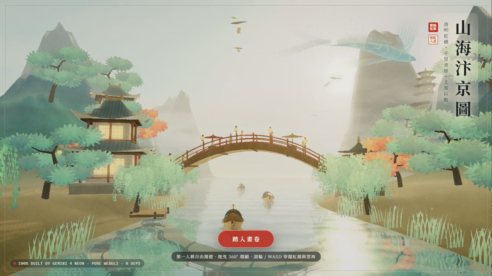
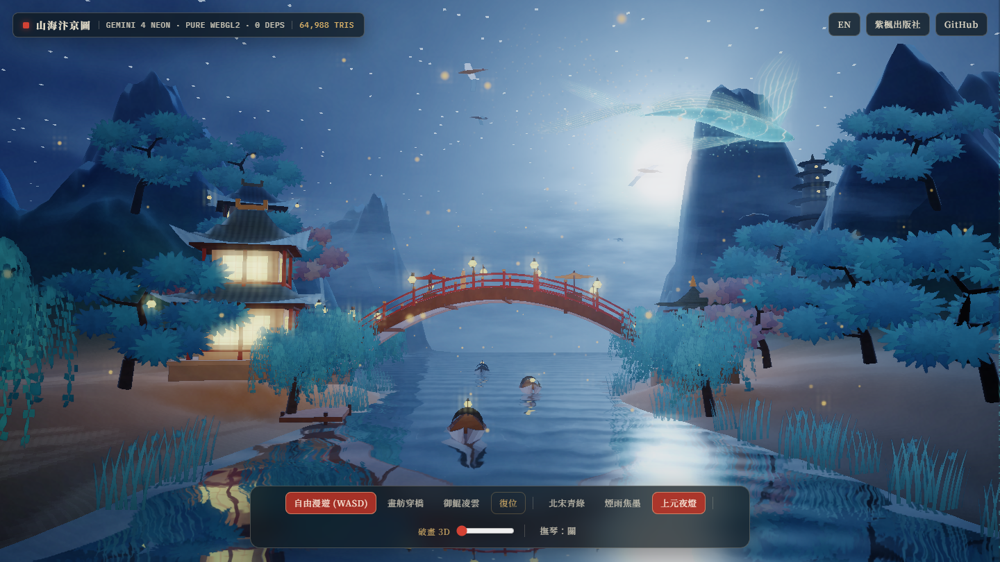
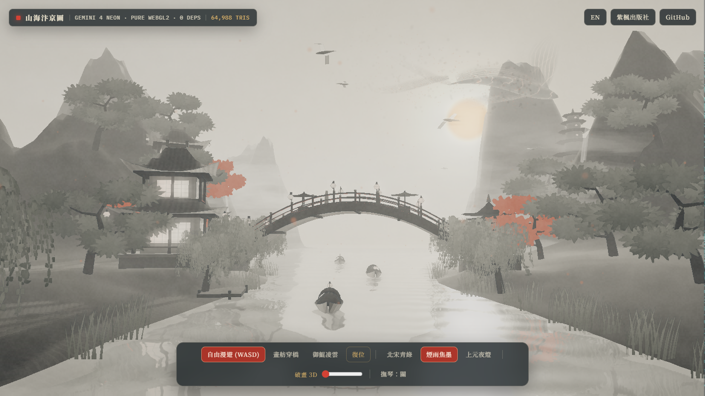
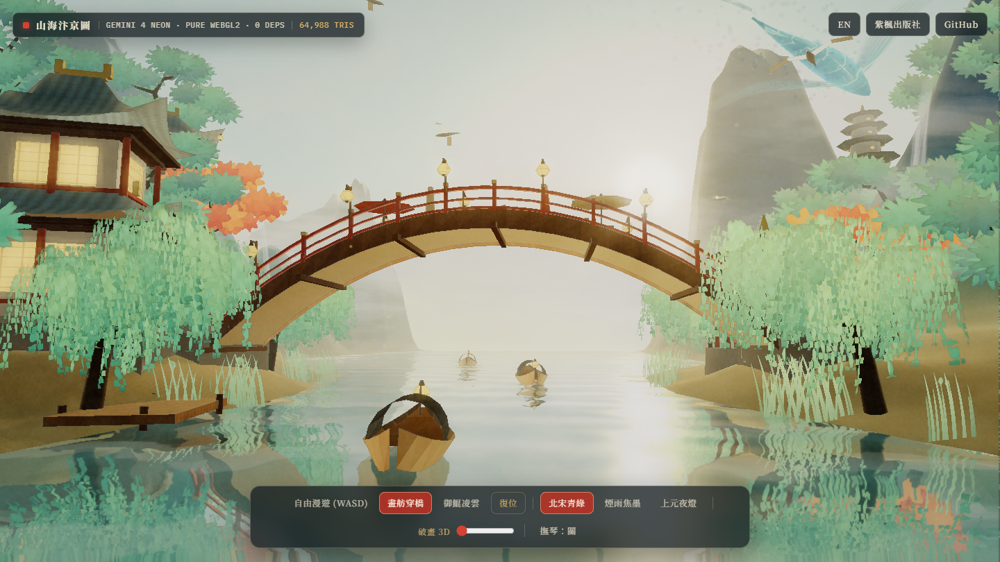
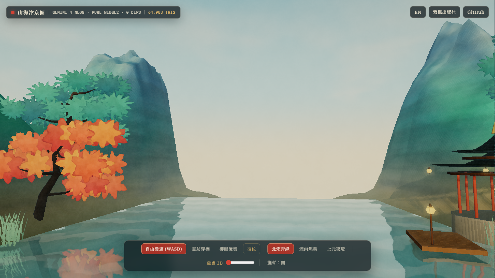

# 《山海汴京圖》Shan Hai Bianjing 3D

**Looks like a museum Song-Dynasty ink scroll — until you drag the mouse and fly 360° in first person under the Rainbow Bridge beneath a celestial *Shan Hai Jing* Giant Kun.**

> **100% autonomously architected, coded, and visually iterated by Gemini 4 Neon.**
> Pure native **WebGL2 + GLSL ES 3.00 + Web Audio API** — **zero external dependencies** (no Three.js, no Babylon.js, no textures, no 3D model files).

### Live Interactive Scroll
- **Enter the Living Painting**: https://tbpfs.github.io/shan-hai-scroll-3d/
- **Split-Curtain 3D X-Ray (`Song Painting ↔ 64,988-Tri Wireframe`)**: https://tbpfs.github.io/shan-hai-scroll-3d/?enter=1&curtain=0.5
- **Lantern Night Mode (`上元夜燈`)**: https://tbpfs.github.io/shan-hai-scroll-3d/?enter=1&style=night
- **Sumi-e Wet Ink Mode (`煙雨焦墨`)**: https://tbpfs.github.io/shan-hai-scroll-3d/?enter=1&style=mono
- **First-Person River Cruise under Rainbow Bridge (`畫舫穿橋`)**: https://tbpfs.github.io/shan-hai-scroll-3d/?enter=1&mode=cruise
- **Cloud-Sea Flight beside the Spirit Kun (`御鯤凌雲`)**: https://tbpfs.github.io/shan-hai-scroll-3d/?enter=1&mode=soar

---


## Visual Showcase (Real WebGL2 Captures)

| Opening Song Scroll (`北宋青綠`) | Lantern Night (`上元夜燈`) |
| :---: | :---: |
|  |  |

| Sumi-e Monochrome (`煙雨焦墨`) | River Cruise under Rainbow Bridge (`畫舫穿橋`) |
| :---: | :---: |
|  |  |

| Soaring beside the Spirit Kun (`御鯤凌雲`) | 180° Reverse First-Person Vista |
| :---: | :---: |
|  |  |

---

## Technical Architecture (5-Pass Native WebGL2 Pipeline)

All ~65,000 triangles, textures, brushstrokes, water reflections, shadows, and Guqin acoustics are procedurally synthesized in pure JavaScript and GLSL ES 3.00:

1. **Pass 1 — Sun Directional Soft Shadow Map (`1024×1024` `DEPTH_COMPONENT24`)**
   - 5-tap PCF soft shadows across the karst peaks, wooden Rainbow Bridge, curved Song pavilions, and stone piers.
2. **Pass 2 — True Planar Mirror Water Reflection (`0.5×` FBO)**
   - Renders the scene mirrored across `y = 0` with fragment plane clipping; the Bianhe River samples the reflection FBO warped by dual-octave scrolling ink-water ripples + Schlick Fresnel + sun/moon specular shimmer.
3. **Pass 3 — Full-Res MRT Main Scene (`tColor`, `tData`, `tWire`)**
   - **Karst Gorge & *千里江山圖* Mineral Shading**: `152×152` ridged-multifractal terrain with anisotropic *Fu-Pi Cun* (斧劈皴) rock brushwork, mineral azurite/malachite/ochre strata, gold-leaf sunlit crests, and height-stratified valley mist.
   - **Hero Song Architecture**: Parabolic interlocking timber Rainbow Bridge (`汴水虹橋`) with continuous sloped vermilion railings, hanging lanterns, oiled-paper parasols, sweeping concave upturned-eave pavilions (`飛檐翹角`), octagonal waterside pavilion, cliff tower, and cloud pagoda.
   - **GPU Calligraphic Brushstroke Foliage**: Procedurally painted pine needle fans, fountain-arched weeping willow cascades, autumn cinnabar maples, and wind-bent waterside reeds (`FS_FOLIAGE`) — zero primitive sphere trees.
   - **Ethereal Spirit Kun & Sea of Clouds**: 44-ring smooth-normal celestial whale-leviathan with gossamer silk-filigree wings, drifting valley cloud ribbons, multi-strand cliff waterfalls, and 1,050 glowing spirit embers & fireflies.
4. **Pass 4 — Quarter-Res Volumetric Sun God-Rays + Separable Gaussian Bloom**
   - 18-step screen-space radial crepuscular shafts piercing through mountain gaps & under the Rainbow Bridge, blended with 9-tap separable bloom on lanterns, lit windows, and Kun runes.
5. **Pass 5 — Adaptive Painterly Kuwahara Filter + Song Paper + Live 3D Split Curtain**
   - 4-sector Kuwahara brushwork smoothing modulated by material type, delicate dry-brush calligraphic edge accents (fading cleanly in mist), antique Xuan-paper fiber warmth, ACES filmic grading, and a live barycentric 3D wireframe curtain.

---

## Controls

- **Mouse / Touch Drag**: 360° First-Person Free-Look (works in Free Fly, River Cruise, and Cloud Soar!)
- **Mouse Wheel / `W A S D` / Arrow Keys**: Smooth first-person flight (`Space`/`E` up, `Shift`/`Q` down) with automatic terrain, water & bridge collision safety
- **`X` Key**: Toggle 50% Song Painting ↔ 3D Wireframe split curtain
- **`1` / `2` / `3` Keys**: Switch between Song Jade (`北宋青綠`), Sumi-e Ink (`煙雨焦墨`), and Lantern Night (`上元夜燈`)
- **`R` Key**: Reset first-person viewpoint

---

## Local Run & Verification

```bash
python -m http.server 8080
# Open http://localhost:8080/
python tests/verify_scroll.py
```

---

## Credits & Ecosystem

- **Creator & Art Direction**: [紫楓 (Purple Maple)](https://ai-purplemaple.com/) · [Purple Maple Press `/learn/`](https://ai-purplemaple.com/learn/) · [@tbpfs1](https://x.com/tbpfs1)
- **Autonomous Engineering**: Gemini 4 Neon
- **License**: [MIT](LICENSE)
