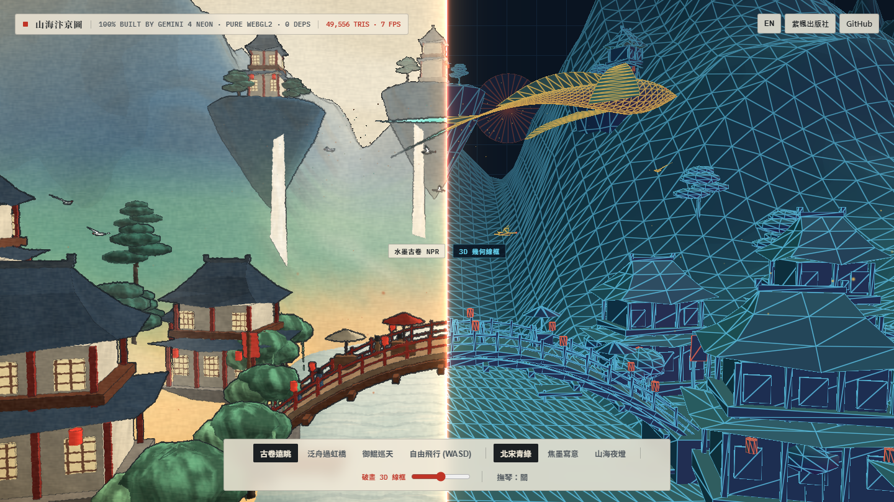
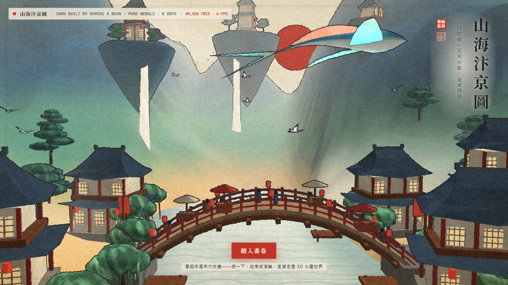
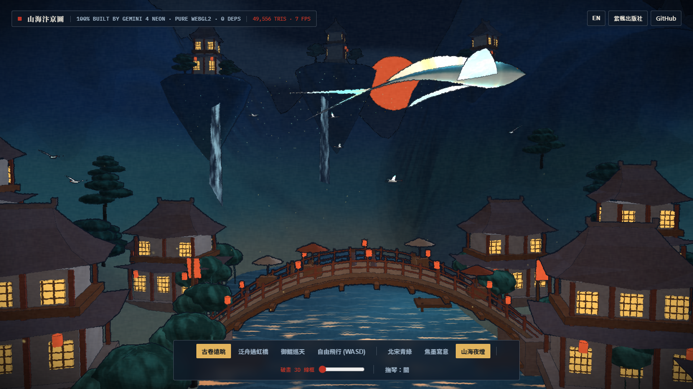
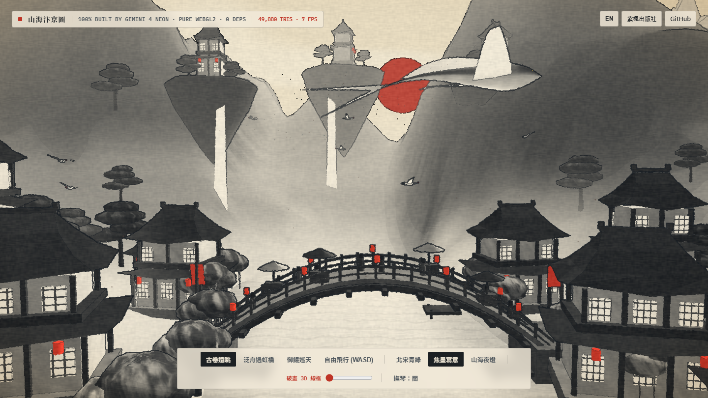

# 山海汴京圖 · Shan Hai Bianjing 3D

**Step Inside a Living Song-Dynasty Ink Scroll — *Qingming Scroll* × *Shan Hai Jing* in Pure WebGL2**

[](https://tbpfs.github.io/shan-hai-scroll-3d/?lang=en)
[-2e6058?style=flat-square)](#technical-architecture)
[](https://tbpfs.github.io/shan-hai-scroll-3d/)
[](LICENSE)

> **At first glance it looks like a quiet Northern-Song blue-green ink painting.**  
> **Click, drag, or scroll — and the 2D scroll unfolds into a live, navigable 3D world.**  
> Sail beneath the timber arch **Rainbow Bridge (虹橋)** from *Along the River During the Qingming Festival*, watch the giant mythical **Kun (北冥巨鯤)** from *Shan Hai Jing* soar past **Penglai floating peaks** and cascading ink waterfalls, or drag the **3D Wireframe Curtain** to reveal the real-time geometry underneath.
>
> **100% autonomously built by Gemini 4 Neon** — zero Three.js, zero external 3D models, zero image textures, zero audio files.

**Launch Live Experience**: [繁體中文版 (Enter the Scroll)](https://tbpfs.github.io/shan-hai-scroll-3d/) · [English Version](https://tbpfs.github.io/shan-hai-scroll-3d/?lang=en) · [3D Wireframe Split View](https://tbpfs.github.io/shan-hai-scroll-3d/?enter=1&curtain=0.5) · [Lantern Night Mood](https://tbpfs.github.io/shan-hai-scroll-3d/?enter=1&style=night)

---

### The Plot Twist: Song-Dynasty Ink Scroll ↔ Real-Time 3D Mesh Curtain



### First Frame: Classic Song-Dynasty Blue-Green Scroll (`北宋青綠`)



### Lantern Night Mood (`山海夜燈`) & Monochrome Sumi-e (`焦墨寫意`)





---

## Interactive Experiences Inside the Scroll

* **4 Camera Modes**:
  1. **Scroll Vista (`古卷遠眺`)** — Classic Song telephoto framing (`37° FOV`), click & drag to orbit 360° or scroll to fly in.
  2. **Sail Bridge (`泛舟過虹橋`)** — Drop down to river level and glide straight beneath the woven timber arch of the Rainbow Bridge.
  3. **Ride the Kun (`御鯤巡天`)** — Wingman chase camera soaring alongside the swimming *Shan Hai Jing* Giant Kun past Penglai waterfalls.
  4. **Free Fly (`WASD`)** — Explore any corner of Bianjing town, the river docks, or the floating mountain pagodas.
* **3 Real-Time Ink Moods**:
  * **Song Blue-Green (`北宋青綠`)** — Mineral azurite peaks, malachite slopes, warm ochre foothills, and Xuan-paper mist inspired by *A Thousand Li of Rivers and Mountains*.
  * **Sumi-e Monochrome (`焦墨寫意`)** — Pure ink-wash grayscale preserving only imperial cinnabar sun & silk lanterns.
  * **Lantern Night (`山海夜燈`)** — Indigo ink nightscape with glowing Song wooden lattice windows, shimmering river reflections, and a luminescent cyan-gold Kun.
* **Real-Time 3D Wireframe Curtain (`X` key or bottom slider)**: Smoothly slice the painting open with a cinnabar scan beam to expose the anti-aliased 3D triangle mesh (`~49k` procedural triangles) rendered live underneath.
* **Zero-Asset Procedural Web Audio (`撫琴`)**: Real-time synthesized Song-Dynasty Guqin harmonics (D-Pentatonic `宮商角徵羽`), valley breeze, and deep ethereal Kun calls.

---

## Technical Architecture {#technical-architecture}

| Layer | Implementation (100% Native Web · Zero Dependencies) |
| :--- | :--- |
| **Procedural 3D World** ([`assets/geometry.js`](assets/geometry.js)) | Ridged multifractal mountain valley, curved Bianhe river, 20-segment interlocking timber Rainbow Bridge with stalls & pedestrians, 10 multi-tier hip-and-gable Song pavilions, organic multi-cluster weeping willows & pines, 3 Penglai floating peaks with waterfalls, 3 gliding riverboats, 9 flapping cranes, and a smooth-normal sculpted 32-ring Giant Kun. |
| **Two-Pass MRT WebGL2 NPR** ([`assets/engine.js`](assets/engine.js)) | **Pass 1** outputs 3 MRT buffers simultaneously (`tColor`, `tNormDepth`, and barycentric AA `tWire`) with vertex-shader swimming/wing animations, anisotropic cliff brushwork (*Fu-Pi Cun* 斧劈皴), procedural window mullions, and aerial cloud-sea mist. **Pass 2** runs dual-channel Sobel depth+normal ink outlining with subtle UV ink-bleed jitter, procedural antique Xuan-paper fibers, and the split wireframe curtain. |
| **Procedural Audio** ([`assets/audio.js`](assets/audio.js)) | Native Web Audio API Guqin pitch-slide plucking, integer-overtone bell harmonics, stereo valley delay reverb, filtered wind noise, and `DynamicsCompressorNode`. |

---

## Run & Verify Locally

```bash
python tests/verify_scroll.py
python -m http.server 8080
# Open http://localhost:8080/ (zh-Hant) or http://localhost:8080/?lang=en
```

---

## Credits & License

* **Autonomous Code, 3D Geometry & GLSL Shaders**: **Gemini 4 Neon** (Google)
* **Concept & Direction**: **Purple Maple (紫楓 / [@tbpfs1](https://x.com/tbpfs1))** — [ai-purplemaple.com](https://ai-purplemaple.com/) · [Purple Maple Press (`/learn`)](https://ai-purplemaple.com/learn/)
* **License**: [MIT License](LICENSE)
