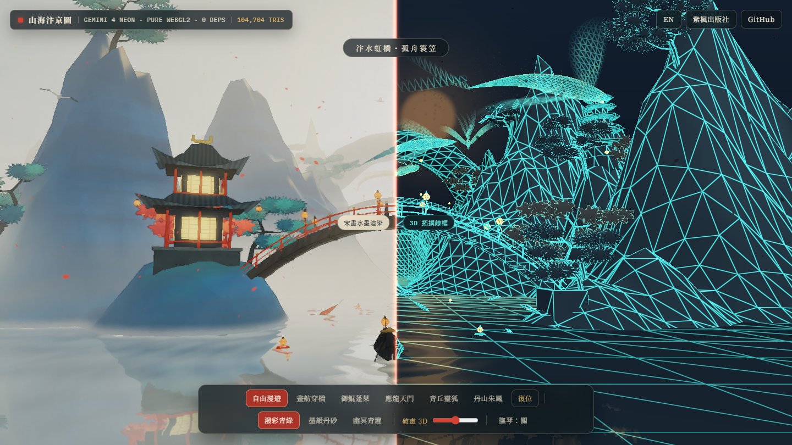
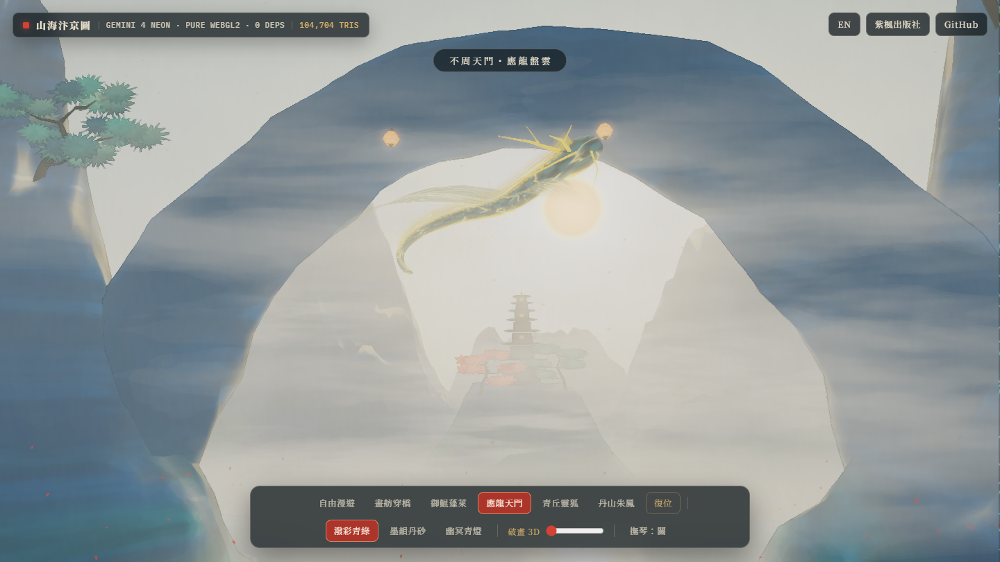
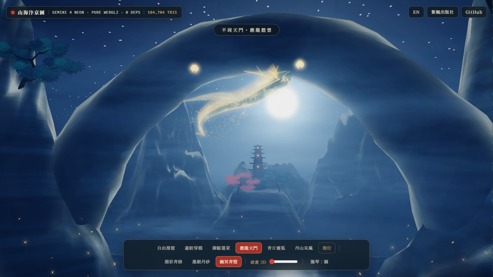
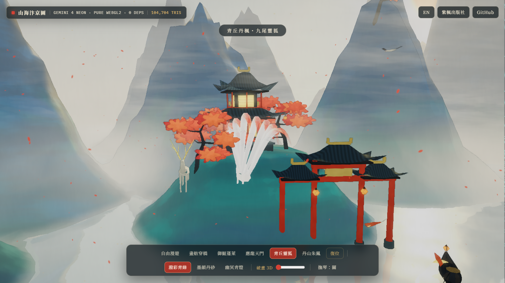
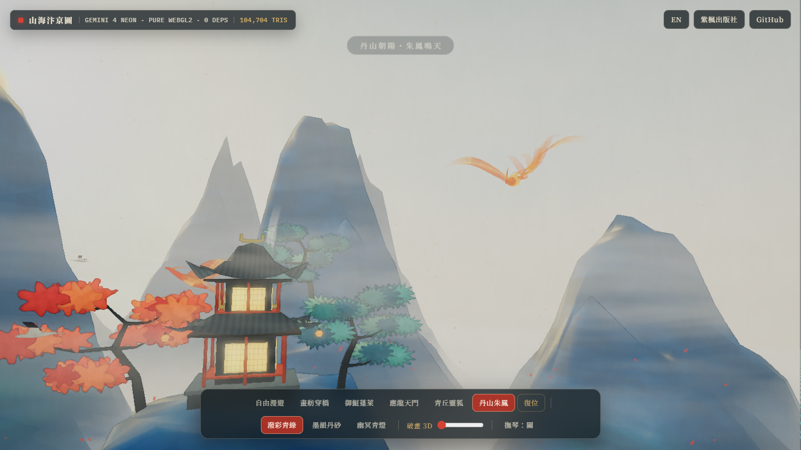

# 《山海汴京圖》Shan Hai Bianjing 3D (v4 — 4 Realms × 7 Living Mythic Creatures)

**Looks like a museum Song-Dynasty splash-ink scroll — until you drag the mouse and fly 360° across a 380m × 400m living *Shan Hai Jing* world inhabited by 7 animated mythic creatures.**

> **100% autonomously architected, coded, and visually iterated by Gemini 4 Neon.**
> Pure native **WebGL2 + GLSL ES 3.00 + Web Audio API** — **zero external dependencies** (no Three.js, no textures, no 3D model files, no audio files).

### Live Interactive Scroll (4 Realms · 104,700+ Procedural Triangles)
- **Enter the Living Painting (`潑彩青綠`)**: https://tbpfs.github.io/shan-hai-scroll-3d/
- **Split-Curtain 3D X-Ray (`Fine-Art Painting ↔ 104,704-Tri Wireframe`)**: https://tbpfs.github.io/shan-hai-scroll-3d/?enter=1&curtain=0.5
- **Mount Buzhou Celestial Gate & 70m Winged Yinglong Dragon (`應龍天門`)**: https://tbpfs.github.io/shan-hai-scroll-3d/?enter=1&mode=dragon
- **Mount Buzhou Dragon in Moonlit Gold (`應龍天門・幽冥青燈`)**: https://tbpfs.github.io/shan-hai-scroll-3d/?enter=1&mode=dragon&style=night
- **Qingqiu Cinnabar Maple Isles — Nine-Tailed Spirit Foxes & White Spirit Stag (`青丘靈狐`)**: https://tbpfs.github.io/shan-hai-scroll-3d/?enter=1&mode=qingqiu
- **Eastern Danshan Sun Spire — Soaring Vermilion Phoenixes (`丹山朱鳳`)**: https://tbpfs.github.io/shan-hai-scroll-3d/?enter=1&mode=phoenix
- **Penglai Gorge — Twin Celestial Spirit Kuns (`御鯤蓬萊`)**: https://tbpfs.github.io/shan-hai-scroll-3d/?enter=1&mode=soar
- **Ink & Cinnabar Mode (`墨韻丹砂` — Sumi-e × Vermilion)**: https://tbpfs.github.io/shan-hai-scroll-3d/?enter=1&style=mono

---

## Explore All 4 Realms & 7 Living *Shan Hai Jing* Creatures (Real WebGL2 Captures)

| Opening Song Scroll (`汴水虹橋・孤舟簑笠`) | Mount Buzhou Gate & 70m Winged Dragon (`不周天門・應龍盤雲`) |
| :---: | :---: |
|  |  |

| Moonlit Dragon Gate (`不周天門・幽冥青燈`) | Qingqiu Isles: Nine-Tailed Foxes & Spirit Stag (`青丘丹楓・九尾靈狐`) |
| :---: | :---: |
|  |  |

| Danshan Sun Spire & Vermilion Phoenixes (`丹山朝陽・朱鳳鳴天`) | Penglai Cloud Gorge & Twin Spirit Kuns (`蓬萊雲海・北冥雙鯤`) |
| :---: | :---: |
|  |  |

| Ink & Cinnabar Mode (`墨韻丹砂`) | Moonlit Gold Mode (`幽冥青燈`) |
| :---: | :---: |
|  |  |

---

## The 7 Living Creatures & 4 Mythic Realms

1. **《山海經・應龍》70m Winged Sky-Dragon**: Sinuous 56-ring serpentine body with branching golden antlers, flowing whiskers, golden dorsal crest, and gossamer cloud-wings coiling through the 75m **Mount Buzhou Celestial Stone Arch** above a 7-Tier Imperial Pagoda.
2. **《山海經・北冥雙鯤》Twin Celestial Kuns**: Mother Kun + companion golden-jade Calf Kun gliding through Penglai Gorge past 6 silk cliff waterfalls and the Cloud Sky-Bridge.
3. **《山海經・丹山朱鳳》3 Vermilion Phoenixes**: Deep cinnabar-crimson and molten-gold mythic birds trailing 5 billowing 15m silk plumes around the Eastern Sun Spire.
4. **《山海經・青丘九尾狐》2 Nine-Tailed Spirit Foxes**: Volumetric Xuan-white silk foxes with 9 arched crimson-tipped mist tails swaying beside the Qingqiu Vermilion Paifang archway.
5. **《山海經・九色靈鹿》2 Golden-Antlered White Spirit Stags**: Serene luminous cliff stags crowned with glowing branching golden antlers.
6. **《山海經・文鰩錦鯉》28 Leaping Spirit Koi / Flying Fish**: Schools of vermilion-gold fish swimming and leaping arcs right out of the mirror ink sea beside the Lone Boatman and shrines.
7. **《宋畫・丹頂墨鶴》18 Soaring Ink Cranes & 4 Lantern Boats**: Thermal flocks of cranes, 4 drifting bamboo-hatted Song boats, 12 floating water-lotus lanterns, and 1,650 3D swirling crimson maple petals & spirit sparks.

---

## Fine-Art Rendering Architecture (Pure WebGL2, 0 External Deps)

- **Mountain-Base Mist Dissolution (`山腳留白・水天一色`)**: Zero muddy 3D dirt slopes; 47 multi-shouldered karst monoliths rise directly out of an infinite mirror ink sea and dissolve softly into gold-flecked Xuan paper.
- **Domain-Warped Splash-Ink Shading (`張大千潑彩 × 千里江山金碧`)**: Replaces plastic 3D Lambert shading with wet-on-wet mineral turquoise/azurite pigment blooms, 5-tone ink quantization (`墨分五色`), vertical *Fu-Pi Cun* brushwork, and sunlit gold-leaf ridges.
- **Capillary Xuan-Paper Ink-Bleed + Watercolor Wet-Edge Pooling (`宣紙滲墨・水痕邊`)**: Organic rice-paper fiber UV displacement softens straight polygon edges, paired with natural pigment-pooling rims, 4-sector Kuwahara brushwork, planar mirror water reflections, PCF soft shadows, volumetric god-rays, and separable bloom.

---

## Controls

- **Mouse / Touch Drag**: 360° First-Person Free-Look (works in Free Fly and all guided tours!)
- **`W A S D` / Arrow Keys / Wheel**: Smooth first-person flight (`Shift` = **2.4× Wind-Glide Turbo**, `Space`/`E` up, `Q` down) across the entire 380m × 400m scroll
- **`X` Key**: Toggle 50% Song Painting ↔ 3D Wireframe split curtain
- **`1` / `2` / `3` Keys**: Switch between `潑彩青綠`, `墨韻丹砂`, and `幽冥青燈`
- **`R` Key**: Reset to opening scroll viewpoint

---

## Credits & Ecosystem

- **Creator & Art Direction**: [紫楓 (Purple Maple)](https://ai-purplemaple.com/) · [Purple Maple Press `/learn/`](https://ai-purplemaple.com/learn/) · [@tbpfs1](https://x.com/tbpfs1)
- **Autonomous Engineering**: Gemini 4 Neon
- **License**: [MIT](LICENSE)
