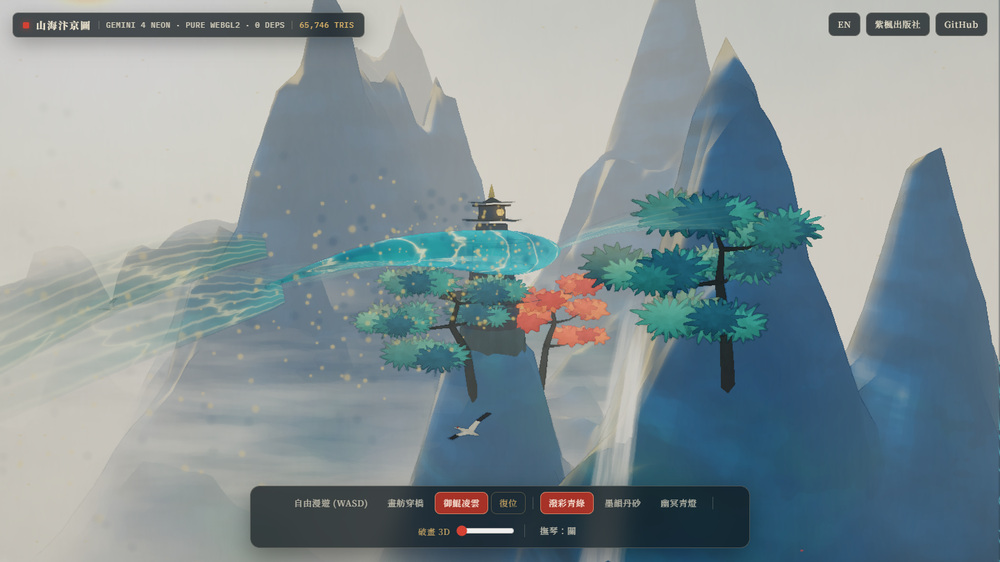

# 《山海汴京圖》Shan Hai Bianjing 3D

**Looks like a museum Song-Dynasty ink scroll — until you drag the mouse and fly 360° in first person under the Rainbow Bridge beneath a celestial *Shan Hai Jing* Giant Kun.**

> **100% autonomously architected, coded, and visually iterated by Gemini 4 Neon.**
> Pure native **WebGL2 + GLSL ES 3.00 + Web Audio API** — **zero external dependencies** (no Three.js, no Babylon.js, no textures, no 3D model files).

### Live Interactive Scroll (v3 Fine-Art Splash-Ink Edition)
- **Enter the Living Painting (`潑彩青綠`)**: https://tbpfs.github.io/shan-hai-scroll-3d/
- **Split-Curtain 3D X-Ray (`Fine-Art Painting ↔ 65,746-Tri Wireframe`)**: https://tbpfs.github.io/shan-hai-scroll-3d/?enter=1&curtain=0.5
- **Ink & Cinnabar Mode (`墨韻丹砂` — Sumi-e × Vermilion)**: https://tbpfs.github.io/shan-hai-scroll-3d/?enter=1&style=mono
- **Moonlit Gold Mode (`幽冥青燈` — Full Moon & Rippling Reflections)**: https://tbpfs.github.io/shan-hai-scroll-3d/?enter=1&style=night
- **First-Person River Cruise (`畫舫穿橋` — glide past the lone boatman under the arch)**: https://tbpfs.github.io/shan-hai-scroll-3d/?enter=1&mode=cruise
- **Cloud-Sea Flight beside the Spirit Kun (`御鯤凌雲`)**: https://tbpfs.github.io/shan-hai-scroll-3d/?enter=1&mode=soar

---


## Visual Showcase (Real WebGL2 Captures)

| Opening Song Scroll (`北宋青綠`) | Lantern Night (`上元夜燈`) |
| :---: | :---: |
|  |  |

| Sumi-e Monochrome (`煙雨焦墨`) | River Cruise under Rainbow Bridge (`畫舫穿橋`) |
| :---: | :---: |
|  |  |

| Soaring beside the Spirit Kun (`御鯤凌雲`) | 180° Reverse First-Person Vista |
| :---: | :---: |
|  |  |

---

## Fine-Art Rendering Architecture (Hiding WebGL Limits Through Pure Art Direction)

All ~65,700 triangles, splash-ink mineral washes, paper fibers, water reflections, and Guqin acoustics are synthesized in pure JavaScript and GLSL ES 3.00:

1. **Zero Muddy Ground Terrain — Mountain-Base Mist Dissolution (`山腳留白・雲斷山腰`)**
   - Seven receding layers of multi-shouldered karst peaks rise directly out of an infinite mirror ink sea; distant mountain bases dissolve seamlessly into luminous gold-flecked Xuan paper so there are zero "video-game ground seams."
2. **Domain-Warped Splash-Ink Shading (`張大千潑彩 × 千里江山金碧`)**
   - Replaces plastic 3D Lambert shading with 2-stage domain-warped watercolor pigment blooms, soft 5-tone ink quantization (`墨分五色`), vertical *Fu-Pi Cun* rock brushwork, and sunlit gold-leaf ridge highlights (`泥金勾勒`).
3. **True Planar Mirror Water + Lone Boatman Concentric Ink Ripples (`孤舟漣漪`)**
   - Half-res mirrored camera FBO reflects the moon-arch bridge, cliff pavilion, lantern tassels, crimson maples, and Spirit Kun with expanding concentric ink rings around the lone bamboo-hatted boatman.
4. **Capillary Xuan-Paper Ink-Bleed UV Warp + Watercolor Wet-Edge Pooling (`水痕邊`)**
   - Gently displaces screen UV along organic rice-paper fiber gradients before sampling so straight polygon edges tremble like wet ink soaking into handmade paper, paired with natural pigment-pooling rims, 4-sector Kuwahara brushwork, and scattered gold-leaf paper flecks (`灑金宣紙`).
5. **Volumetric Sun/Moon God-Rays + Separable Bloom + 3D Swirling Crimson Petals (`落紅如雨`)**
   - 16-step radial crepuscular shafts, soft separable bloom, and 1,150 tumbling 3D maple petals, gold-leaf sparks, and sumi smoke particles.

---

## Controls

- **Mouse / Touch Drag**: 360° First-Person Free-Look (works in Free Fly, River Cruise, and Cloud Soar!)
- **Mouse Wheel / `W A S D` / Arrow Keys**: Smooth first-person flight (`Space`/`E` up, `Shift`/`Q` down) with automatic terrain, water & bridge collision safety
- **`X` Key**: Toggle 50% Song Painting ↔ 3D Wireframe split curtain
- **`1` / `2` / `3` Keys**: Switch between Song Jade (`北宋青綠`), Sumi-e Ink (`煙雨焦墨`), and Lantern Night (`上元夜燈`)
- **`R` Key**: Reset first-person viewpoint

---

## Local Run & Verification

```bash
python -m http.server 8080
# Open http://localhost:8080/
python tests/verify_scroll.py
```

---

## Credits & Ecosystem

- **Creator & Art Direction**: [紫楓 (Purple Maple)](https://ai-purplemaple.com/) · [Purple Maple Press `/learn/`](https://ai-purplemaple.com/learn/) · [@tbpfs1](https://x.com/tbpfs1)
- **Autonomous Engineering**: Gemini 4 Neon
- **License**: [MIT](LICENSE)
